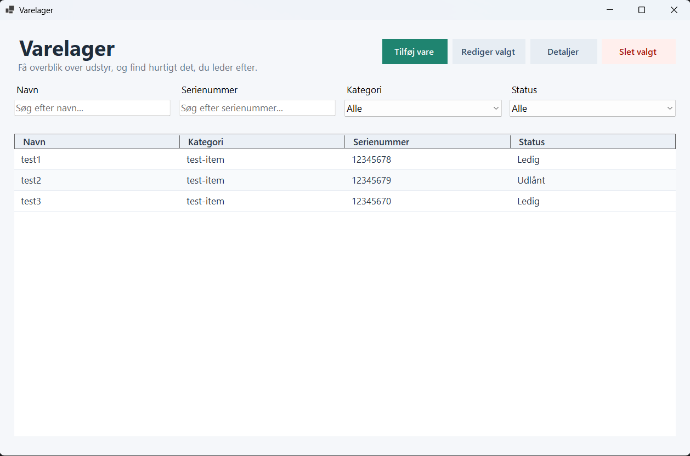
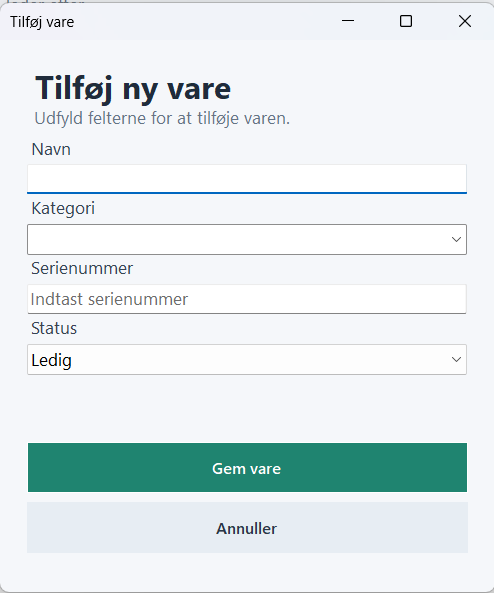
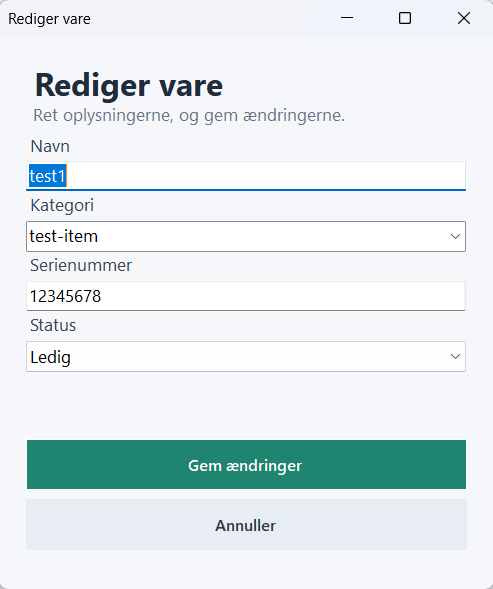
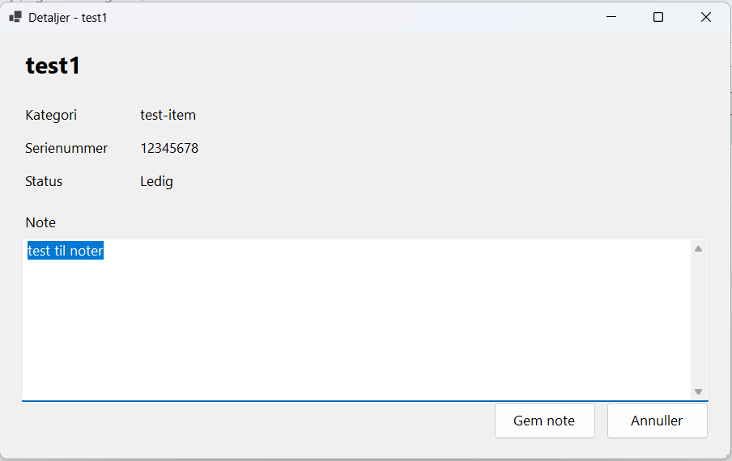
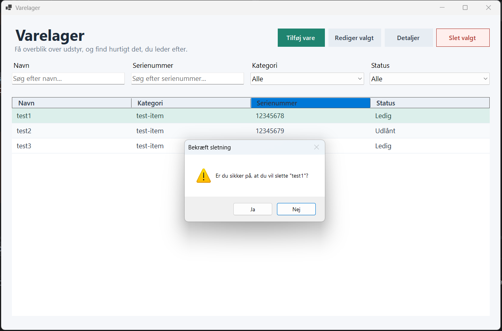

# Varelager

Et Windows Forms-program til at registrere og finde udstyr. Programmet er skrevet i C# og kræver Windows.

## Kør programmet

Åbn `GUI-programmering-Desktop-application.sln` i Rider eller Visual Studio, og kør projektet. Udstyrsdata gemmes kun i hukommelsen og forsvinder, når programmet lukkes.

## Skærmbilleder

### Hovedformular

### Tilføj udstyr

### Rediger udstyr

### Udstyrsdetaljer

### Bekræft sletning

## Event handlers

- `AddNewItem_Click` åbner formularen til oprettelse. Når brugeren gemmer gyldige oplysninger, føjes udstyret til tabellen, og kategori-filteret og visningen opdateres.
- `FilterControls_Changed` reagerer på ændringer i søgefelterne og filtrene og kalder `ApplyFilters`, som viser de rækker, der matcher navn, serienummer, kategori og status.

Tabelvalg håndteres også af `ItemsGrid_SelectionChanged`, som aktiverer eller deaktiverer knapperne til redigering, detaljer og sletning.

## Layout

`TableLayoutPanel` organiserer de fire søge- og filterfelter i en overskuelig række med etiketter over kontrollerne. Hovedformularen bruger desuden `Anchor` til at holde knapper og søgefelter ved deres kanter, mens tabellen strækkes med vinduet. Det adskiller søgning og handlinger fra udstyrsoversigten.

Detaljer åbnes i et separat dialogvindue via knappen **Detaljer**; de vises ikke i et fast højre panel på hovedformularen.

## Funktioner

Hovedformularen viser udstyr i en tabel med navn, kategori, serienummer og status. Brugeren kan oprette og redigere udstyr, se og gemme en note i detaljevinduet, slette med bekræftelse samt søge og filtrere. Udstyr repræsenteres af `Equipment`-klassen.

Status kan sættes til **Ledig** eller **Udlånt** ved oprettelse og redigering. Der er ikke en særskilt knap til at markere et valgt udstyr som udlånt.
